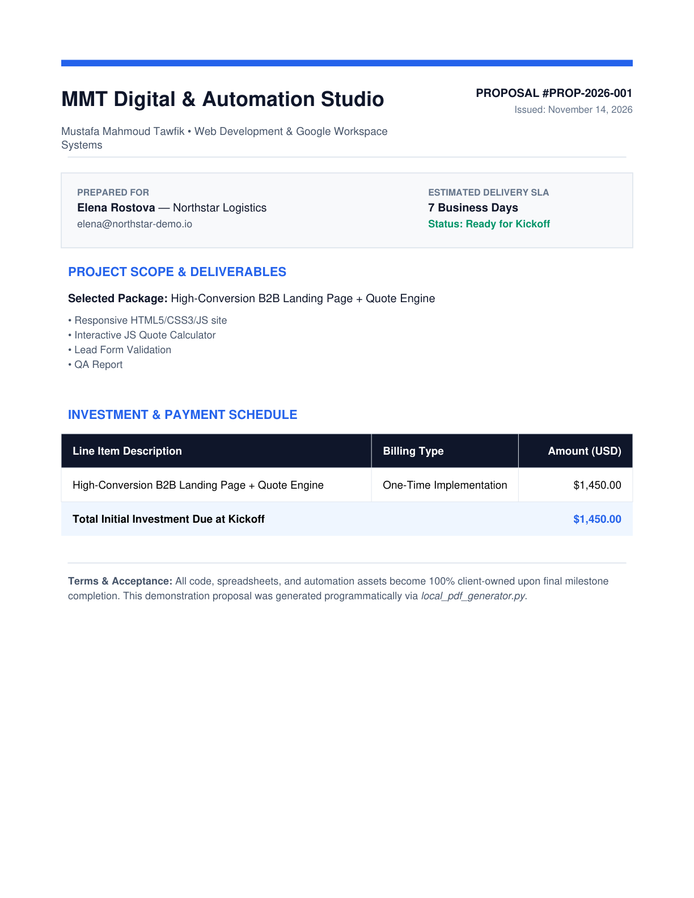

# Automated Lead-to-Proposal & PDF Invoice Generator

> **Notice:** This project is an **Original Open-Source Showcase / Demonstration System** engineered from scratch for portfolio and educational demonstration. All client profiles and pricing figures in `sample_clients.csv` are synthetic.

---

## 1. Workflow Architecture
This project bridges web forms / CRM spreadsheets to automated, branded Light-Mode PDF proposals and invoices across two execution modes:

1. **Cloud Mode (Google Workspace — `apps_script_pdf_mailer.gs`):**
   - Listens to Google Form submissions or Google Sheet row updates.
   - Injects client metadata into a responsive Light-Mode HTML invoice/proposal template.
   - Converts the HTML to a PDF Blob, archives it in a dedicated Google Drive folder (`Generated_Client_Proposals`), emails the PDF to the client via `MailApp`, and stamps the Drive file ID back into the sheet.

2. **Local Batch Mode (Python — `local_pdf_generator.py`):**
   - Reads structured client data from `sample_clients.csv`.
   - Batch-generates high-resolution PDF service proposals using `ReportLab` into `output_proposals/`.
   - Renders a 2x-DPI PNG preview (`screenshots/proposal_preview.png`) using `PyMuPDF` for instant visual QA.

---

## 2. Setup Steps

### A. Local Python Batch Generator
```powershell
cd D:\Freelance_Business\03_Projects\03_Invoice_Report_Generator
pip install reportlab pymupdf
python local_pdf_generator.py
```
Generated PDFs appear in `output_proposals/` and the preview image updates at `screenshots/proposal_preview.png`.

### B. Google Apps Script Cloud Mailer
1. Open your Google Sheet containing lead columns: `Ref_ID | Client_Name | Company | Email | Service_Package | Amount_USD | Timeline_Days | PDF_Status`.
2. Open **`Extensions -> Apps Script`** and paste [`apps_script_pdf_mailer.gs`](apps_script_pdf_mailer.gs).
3. Add an **On form submit** installable trigger pointing to `generateAndSendProposalPDF`.

---

## 3. Target Use Cases
- **Consultants & Agencies:** Send customized scope-of-work PDFs within 10 seconds of a discovery form submission.
- **B2B Service Providers:** Eliminate copy-paste errors in Word/Docs invoicing and maintain an automatic Google Drive audit trail.

---

## 4. Visual Preview

